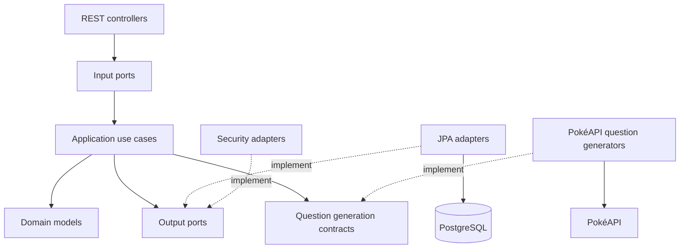
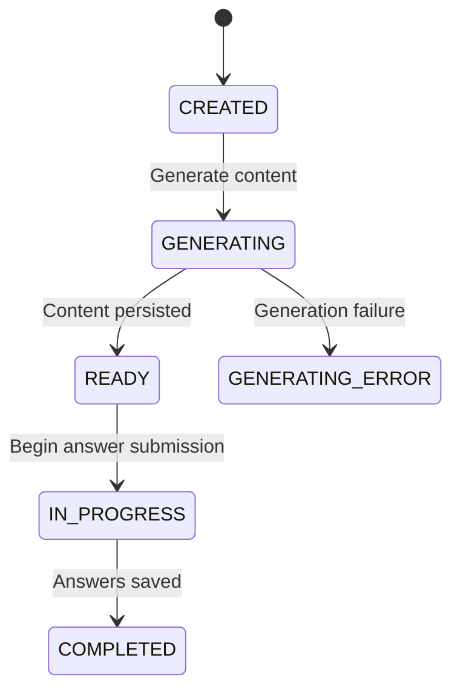

# PokeQuiz

A REST API for generating, managing, and evaluating interactive quizzes. Pokémon is the first supported question source, powered by [PokéAPI](https://pokeapi.co/).

Built with Java 21 and Spring Boot using a hexagonal (ports and adapters) architecture, PokeQuiz separates quiz orchestration, evaluation, and persistence from external data providers. The project is designed to evolve into a more general quiz-generation backend and serve as a practical environment for exploring backend architecture, resilience, and cloud infrastructure.


## Features

- **Dynamic quiz generation:** generate questions about Pokémon names, colors, types, species, and evolution chains using live PokéAPI data.
- **Quiz lifecycle:** create quizzes, generate content, retrieve questions, submit answers, and evaluate completed quizzes.
- **Evaluation:** calculate per-question correctness and an overall percentage score.
- **Difficulty levels:** configurable through persisted difficulty catalogs.
- **Localization:** English and Spanish question templates, selected through the request locale.
- **Authentication:** JWT access tokens, refresh token rotation and revocation, BCrypt password hashing, and role-based authorization.
- **Persistence:** PostgreSQL with UUID identifiers, Spring Data JPA, and versioned Liquibase migrations.
- **API documentation and development environments:** OpenAPI, Swagger UI, Docker Compose, and separate local, QA, and production profiles.

## Architecture

PokeQuiz is a modular backend organized around ports and adapters. Domain models are separate from JPA entities, and application use cases depend on contracts rather than concrete persistence, security, or external API implementations.



The arrows from adapter implementations to ports represent source-code dependencies, not the direction of runtime calls.

| Layer                  | Responsibility                                                                                                           |
|------------------------|--------------------------------------------------------------------------------------------------------------------------|
| `domain`               | Business models, identities, and domain exceptions.                                                                      |
| `application.port.in`  | Use case interfaces, commands, and results for authentication and quizzes.                                               |
| `application.port.out` | Contracts for persistence, authentication, password encoding, and token operations.                                      |
| `application.usecase`  | Quiz and authentication orchestration, generation contracts, state transitions, and evaluation.                          |
| `infrastructure`       | REST controllers, JPA entities and adapters, mappers, Spring Security, PokéAPI integration, and framework configuration. |

Spring manages dependency injection and transaction boundaries in the application layer. The domain does not depend on Spring or JPA. This is a pragmatic hexagonal design, rather than a fully framework-independent application layer.

### Quiz lifecycle



State transitions use conditional repository updates (compare-and-set) to enforce the expected previous state. Question generation and answer evaluation are separate application responsibilities.

The lifecycle above describes the intended state transitions; transaction boundaries and failure recovery are still being refined.

## Technology stack

| Area                  | Technology                                            |
|-----------------------|-------------------------------------------------------|
| Language & build      | Java 21, Maven                                        |
| Application           | Spring Boot 3.5, Spring MVC                           |
| Security              | Spring Security, JJWT, BCrypt                         |
| Persistence           | Spring Data JPA, Hibernate, PostgreSQL 16             |
| Database migrations   | Liquibase                                             |
| External integration  | PokéAPI, Spring REST client infrastructure            |
| Resilience foundation | Spring Cloud CircuitBreaker / Resilience4j dependency |
| API documentation     | springdoc-openapi, Swagger UI                         |
| Testing               | JUnit, Spring Boot Test, Spring Security Test         |
| Containers            | Docker, Docker Compose                                |

See [`pom.xml`](pom.xml) for the exact dependency versions. The presence of the resilience dependency does not imply that circuit breakers, retries, or timeout policies are already configured.

## Getting started

### Prerequisites

- JDK 21 for running the application locally
- Docker and Docker Compose
- Internet access to PokéAPI for quiz generation

Maven Wrapper is included, so a standalone Maven installation is not required for the commands below.

```bash
git clone https://github.com/ctorressoftware/pokequiz.git
cd pokequiz
```

### Option 1 — Run the full QA environment with Docker

```bash
docker compose -f docker-compose.qa.yml up -d --build
```

The API is exposed on port `8080`, and PostgreSQL is exposed on host port `5433`.

```bash
docker compose -f docker-compose.qa.yml logs -f api
```

### Option 2 — Run Spring Boot locally

Start only the database container from the QA Compose file:

```bash
docker compose -f docker-compose.qa.yml up -d db
```

Then run the application with the local profile and the Compose development database settings:

```bash
SPRING_PROFILES_ACTIVE=local \
DB_URL=jdbc:postgresql://localhost:5433/pokequiz_qa \
DB_USER=pokequiz \
DB_PASSWORD=pokequiz \
./mvnw spring-boot:run
```

These database credentials are for the bundled development environment only. Do not use them for a deployed service.

Liquibase runs automatically during startup. Hibernate validates the resulting schema instead of generating or updating it.

### Configuration

Configuration files are located in [`src/main/resources`](src/main/resources): `application.properties`, `application-local.properties`, `application-qa.properties`, and `application-prod.properties`.

| Environment variable     | Purpose                                            |
|--------------------------|----------------------------------------------------|
| `SPRING_PROFILES_ACTIVE` | Select `local`, `qa`, or `prod`.                   |
| `DB_URL`                 | PostgreSQL JDBC URL.                               |
| `DB_USER`                | Database username.                                 |
| `DB_PASSWORD`            | Database password.                                 |
| `TOKEN_SECRET`           | JWT signing secret for QA and production profiles. |

Use external, environment-specific secrets for non-local deployments. Review profile-specific security settings before exposing the API publicly.

## API reference

With the local profile active, open the interactive documentation:

- Swagger UI: <http://localhost:8080/swagger-ui/index.html>
- OpenAPI specification: <http://localhost:8080/v3/api-docs>

### Authentication

| Method | Endpoint         | Purpose                                            |
|--------|------------------|----------------------------------------------------|
| `POST` | `/auth/register` | Create a user and issue tokens.                    |
| `POST` | `/auth/login`    | Authenticate and issue tokens.                     |
| `POST` | `/auth/refresh`  | Rotate a refresh token and issue a new token pair. |
| `POST` | `/auth/logout`   | Revoke the submitted refresh token.                |

Use the access token for protected requests:

```http
Authorization: Bearer <access_token>
```

### Quizzes

Quiz operations require the `USER` role.

| Method | Endpoint                          | Purpose                                                       |
|--------|-----------------------------------|---------------------------------------------------------------|
| `POST` | `/quiz/create`                    | Create a quiz using a difficulty level UUID.                  |
| `POST` | `/quiz/generateAndSaveContent`    | Generate and persist questions for a quiz.                    |
| `GET`  | `/quiz/getQuizById?quizId={uuid}` | Retrieve a quiz and its evaluation, when available.           |
| `POST` | `/quiz/completeQuizAnswers`       | Submit answers, complete the quiz, and return the evaluation. |

A typical workflow is to register or log in, create a quiz, use its returned UUID to generate questions, retrieve the quiz, and submit one answer per question. The generation endpoint accepts `Accept-Language` to select question templates.

For the exact request and response schemas, consult the OpenAPI specification.

## Database migrations

Liquibase changelogs are stored in [`src/main/resources/db/changelog`](src/main/resources/db/changelog). The migration history includes the transition from numeric identifiers to UUIDs and the repopulation of reference catalogs for quiz states, roles, and difficulty levels.

> **Important:** The UUID migration intentionally truncates legacy business data before converting identifiers. It was designed for disposable development and QA data. Do not apply this migration to a database containing information that must be preserved without first preparing a data-preserving migration and backup.

Docker Compose uses a persistent named volume. To stop the QA environment while keeping its data:

```bash
docker compose -f docker-compose.qa.yml down
```

To intentionally reset the disposable QA database and replay all migrations from scratch:

```bash
docker compose -f docker-compose.qa.yml down --volumes
docker compose -f docker-compose.qa.yml up -d --build
```

## Build and test

```bash
./mvnw clean verify
```

To build and run the executable JAR:

```bash
./mvnw clean package
java -jar target/pokequiz.jar
```

Integration and context-loading tests may require a running PostgreSQL instance and a suitable Spring profile. Automated test coverage is being expanded, particularly for use cases, aggregate mapping, API contracts, and concurrency.

## Project status and roadmap

The hexagonal refactor and UUID schema migration are in place. The project has reached the stabilization stage, with further functional testing and production-hardening work planned.

| Status             | Work                                                                                                                                                                                             |
|--------------------|--------------------------------------------------------------------------------------------------------------------------------------------------------------------------------------------------|
| Implemented        | Domain/application separation, ports and adapters, Pokémon question generation, quiz lifecycle and evaluation, JWT authentication, UUID persistence, Liquibase migrations, and containerized QA. |
| Stabilization      | HTTP response contracts, transaction boundaries for external generation, concurrent refresh token rotation, and expanded automated tests.                                                        |
| Planned            | Caffeine caching, endpoint rate limiting, HTTP timeouts, circuit breakers and retry policies, and observability.                                                                                 |
| Future experiments | Additional question-generation adapters, AWS deployment, managed PostgreSQL, asynchronous quiz generation with messaging, and Spring Cloud integrations.                                         |

Pokémon remains the current question source. Additional providers and cloud integrations are roadmap items, not existing features.

## Acknowledgments

Pokémon data is provided by [PokéAPI](https://pokeapi.co/). PokeQuiz is an independent learning project and is not affiliated with or endorsed by the Pokémon franchise or its rights holders.
